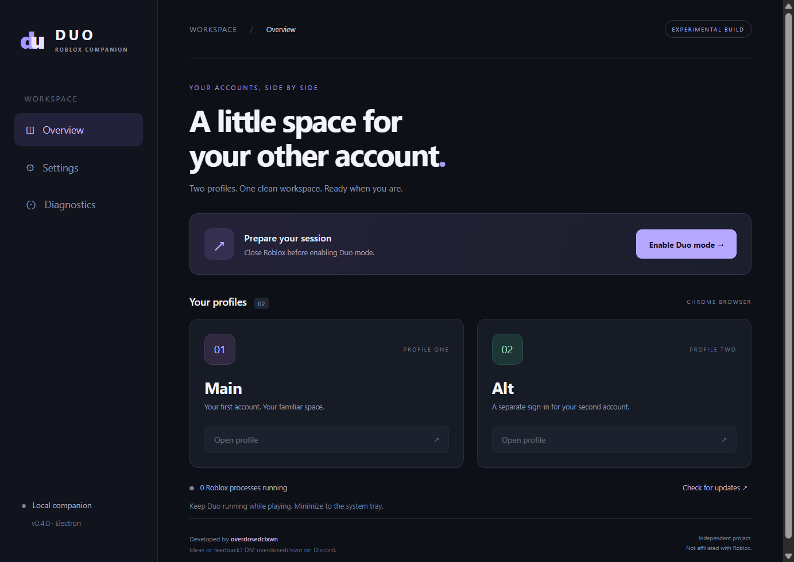

# Roblox Duo 0.4.0 — Electron edition

An experimental Windows companion for two Roblox accounts. Developed by **overdosedclxwn**. Ideas or feedback? DM **overdosedclxwn** on Discord.

**[Download for Windows](https://github.com/clxwnlessss/roblox-duo/releases/tag/v0.4.0)** · [Report an issue](https://github.com/clxwnlessss/roblox-duo/issues)



## Run

Extract the entire Windows ZIP, then run `RobloxDuo.exe` inside the application folder. Keep the files together. Windows 10/11 x64 and .NET Framework 4.x are required. This is an unsigned preview.

Close Roblox, enable Duo mode, open Main and Alt, sign in with different accounts on roblox.com, and press Play in each browser. Two-account gameplay remains unverified; Roblox updates can invalidate the mutex method. An enabled status only confirms that Windows locks are held.

## Features

- Custom Electron interface with separate overview, settings, and diagnostics pages.
- Persistent names and browser choice (Edge, Chrome, Firefox).
- Minimize to tray; double-click its icon to restore. Close/ Quit asks before releasing active locks.
- Manual GitHub update checks; downloads open in the browser after confirmation.
- Separate browser profiles. Existing Edge profile directories from 0.3.0 are preserved. Legacy settings are imported on first use; new settings are in `%LOCALAPPDATA%/RobloxDuo/electron-settings.json`.
- C# helper holds both Roblox mutexes on its main thread. Pipe closure releases locks if the parent app stops. No injection, client patching, password/cookie reading, telemetry, or automatic installs.

## Build

Install Node.js and use PowerShell from this directory:

```powershell
npm ci
npm run build:native
npm test
npm start
npm run package
```

Packaging produces `dist/RobloxDuo-win32-x64`. The Electron build is larger and uses more memory than the old native edition. Renderer runs with context isolation and sandboxing; only narrow validated IPC actions reach the main process. Browser launches use argument arrays without a shell.

The previous native implementation is retained in `src/`, `build.ps1`, and `tests.ps1` for reference; the Electron edition uses the npm commands above. MIT licensed. Not affiliated with Roblox Corporation.
